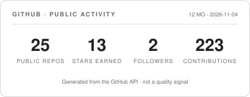
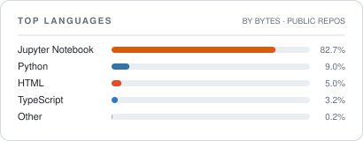

# Ajay Krishna M.

**AI Engineer · LLM systems · Applied AI**

I build agent tools, retrieval systems, and model adaptations that can be evaluated, secured, and operated.

## Languages and tools

Only tools that appear in the public or evaluated work below — no badge wall of things I have not shipped.

## GitHub analytics

<picture>
  <source media="(prefers-color-scheme: dark)" srcset="assets/github-stats-dark.svg">
  
</picture>
<picture>
  <source media="(prefers-color-scheme: dark)" srcset="assets/top-languages-dark.svg">
  
</picture>

Generated from the GitHub API on 2026-11-04 by [`scripts/profile_stats.py`](scripts/profile_stats.py). Activity volume measures usage, not engineering quality — the evidence starts below.

---

I'm an AI engineering student at **IIT G** and the builder behind [Aegis MCP](https://github.com/ajaybe-ops/aegis-mcp), a production-oriented Model Context Protocol server for vulnerability intelligence and incident triage.

My work sits where **LLM tooling, retrieval, and reliability engineering** meet: typed tool surfaces for agents, deterministic risk scoring, evidence-contract evaluations for RAG, and parameter-efficient fine-tuning. I care less about demos that look good once and more about systems that can be re-run, audited, and operated.

**Open to:** AI Engineer, LLM Engineer, and Applied AI roles.

`Python` · `TypeScript` · `MCP` · `RAG` · `PyTorch` · `FastAPI` · `Docker`

[Selected work](#selected-work) · [Achievements](#achievements--milestones) · [Skills](#technical-skills) · [Contact](#contact)

---

## Selected work

### 01 — Aegis MCP

**Agent tooling for vulnerability intelligence and incident triage**  
[Repository](https://github.com/ajaybe-ops/aegis-mcp) · [Architecture](https://github.com/ajaybe-ops/aegis-mcp/blob/main/docs/ARCHITECTURE.md) · Python · MCP · FastAPI · SQLite · OpenTelemetry

A Model Context Protocol server that gives agents a typed, policy-scored surface for CVE lookup, package scanning, and multi-step incident triage across NVD, FIRST EPSS, CISA KEV, and OSV.

- **Tool surface:** 6 MCP tools, 4 resources, and 3 prompts over stdio and streamable HTTP.
- **Agent safety:** JWT/JWKS validation, per-tool scope enforcement, token-bucket rate limits, sanitized untrusted feed text, and fail-closed configuration.
- **Reliability:** TTL/LRU cache with single-flight, retries with jitter, circuit breakers, deadlines, idempotent triage fingerprints, and explicit partial-result coverage.
- **Verified:** **171 tests passing at 91.74% coverage**; **12/12** offline eval scenarios; ruff and strict mypy clean; CI and security workflows green on `main`, including a Docker health/401 smoke test.

### 02 — Enterprise RAG

**Auditable hybrid retrieval with evidence-contract evaluations**  
[Repository](https://github.com/ajaybe-ops/enterprise-rag) · [Architecture](https://github.com/ajaybe-ops/enterprise-rag/blob/main/ARCHITECTURE.md) · Python · FastAPI · BM25 · NumPy LSA

A retrieval system built on one premise: a metric you cannot attribute is a metric you cannot improve. The corpus is a content-addressed, versioned artifact; every run is tied to a manifest, and metric movement is attributed to the corpus, chunking, ranking, or noise.

- **Retrieval:** BM25 plus a dense LSA leg, status-aware ranking, tenant-aware authorization, citation verification, and abstention.
- **Evaluation:** an 87-document seeded corpus and 90 probes across 7 categories: direct, paraphrase, multi-hop, lexical trap, forbidden source, version conflict, and unanswerable.
- **Verified:** **149 tests passing**; recall@5 **0.950**, nDCG@5 **0.920**, MRR **0.811**, fact coverage **1.000**, **0** authorization or version-preference violations at p95 **56 ms**.
- **Honest edge:** multi-hop retrieval is the weakest slice. The repository reports it rather than tuning it away.

### 03 — TensorTonic: 105 ML/DL primitives from scratch

**The mechanics behind modern AI systems, not just library calls**  
[Repository](https://github.com/ajaybe-ops/TensorTonic-Solutions) · Python · NumPy

A verified set of **105 implementations** covering the internals that show up in real LLM and ML debugging: BM25, causal attention masking, GRU cells, batch normalization, GELU, dropout, convolution and pooling, calibration (ECE, isotonic), drift detection, and classical ML.

- One self-contained module per problem; most include a written explanation of the contract and edge cases.
- Built for the failure modes that matter in LLM work: shape bugs, masking bugs, numerical stability, and evaluation errors.
- **Verified:** 105 problem directories and 105 Python implementations in the repository; solutions are synced from TensorTonic, where they are platform-checked.

### 04 — Llama 3.2 3B instruction tuning

**A complete parameter-efficient SFT path**  
[Repository](https://github.com/ajaybe-ops/Finetuning-Llama3.2-3B-) · Python · Unsloth · PEFT/LoRA · TRL

A supervised fine-tuning run on `mlabonne/FineTome-100k`, built to understand the full adaptation path: 4-bit loading, LoRA target selection, chat-template formatting, training, and post-training inference.

- **Setup:** Llama-3.2-3B-Instruct, 4-bit, LoRA rank 16 across attention and MLP projections, max sequence length 2,848.
- **Training:** 100,000-example dataset, 60 optimization steps, effective batch size 16, learning rate 2e-4.
- **Verified from notebook outputs:** **24,313,856 trainable parameters (0.75%)**, training loss **1.017**, **13.0 minutes** on a single Tesla T4.

### Also built

| Project | What it is | Stack |
| --- | --- | --- |
| [Healthcare Diagnostic Platform](https://github.com/ajaybe-ops/healthcare-diagnostic-platform) | Pneumonia CNN model artifact plus an arrhythmia training, evaluation, and explainability pipeline. Not clinically validated. | Python, TensorFlow/Keras, scikit-learn, Streamlit |
| [WhatsApp Audit Export](https://github.com/ajaybe-ops/WhatsApp-Audit-Export) | Deterministic WhatsApp export parser with confidence scoring, a full audit trail, and auditor-ready Excel export. | TypeScript, React, Express, PostgreSQL, ExcelJS |
| [Resonance](https://github.com/ajaybe-ops/Resonance-) | Spotify-connected sing-along app with synchronized lyrics and focus controls. | Next.js, TypeScript, Spotify Web Playback SDK |

---

## Achievements & milestones

| Milestone | Evidence |
| --- | --- |
| **171 tests · 91.74% coverage · 12/12 evals** | Aegis MCP, re-run 2026-11-04 with `pytest --cov` and `aegis-mcp eval` |
| **149 tests · 90 evidence probes · 0 authorization violations** | Enterprise RAG, re-run 2026-11-04 with `uv run pytest -q` and `scripts/evaluate.py` |
| **105 ML/DL primitives implemented from scratch** | TensorTonic Solutions repository |
| **Llama 3.2 3B LoRA: 24.3M trainable parameters (0.75%), loss 1.017, 13 min on a T4** | Fine-tuning notebook with committed training outputs |
| **5 CI jobs across 2 workflows, green on `main`** | Aegis MCP: lint, format, strict mypy, tests, evals, Bandit, pip-audit, Docker health/401 smoke test |

These are engineering checkpoints, not claims about production scale. Each one is reproducible from the linked repository; none are estimated or rounded up.

---

## Technical skills

| Area | Tools used in public or evaluated work |
| --- | --- |
| **LLM & agents** | MCP, tool/function calling, prompt design, RAG, BM25, embeddings/LSA, LoRA/QLoRA, SFT, Hugging Face Transformers, TRL, Unsloth, PEFT |
| **Evaluation** | Evidence-contract design, recall@k, nDCG, MRR, deterministic offline suites, regression gates, coverage |
| **ML & data** | PyTorch, TensorFlow/Keras, scikit-learn, NumPy, pandas, Matplotlib, calibration, drift detection, SQL |
| **Backend** | Python, FastAPI, Pydantic, TypeScript, Node.js, Express, SQLite, PostgreSQL, Drizzle |
| **Frontend** | React, Next.js, Tailwind CSS, shadcn/ui, Vite |
| **Infrastructure & quality** | Docker, GitHub Actions, pytest, ruff, mypy, Bandit, pip-audit, OpenTelemetry, JWT/JWKS, structured logging |

---

## How I work

- **Evaluation before polish.** If a system cannot be re-run and attributed, I do not trust the number.
- **Fail closed, degrade explicitly.** Security checks deny by default; upstream failures return typed partial results with coverage, not silent guesses.
- **Write the limitation down.** The READMEs state what is synthetic, offline, single-node, or unvalidated.

---

## Contact

I'm looking for **AI Engineer / LLM Engineer / Applied AI** roles where evaluation rigor and production reliability matter.

[Email](mailto:ajaykrishiit.uk@gmail.com) · [LinkedIn](https://www.linkedin.com/in/ajaykrishagi/) · [Portfolio](https://ajaybe-ops.github.io/) · [GitHub](https://github.com/ajaybe-ops)

Every metric on this page was re-verified on 2026-11-04 from the linked repository. No estimated or fabricated results. Certifications are listed only when completed and verifiable.
