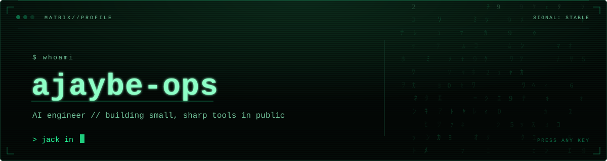
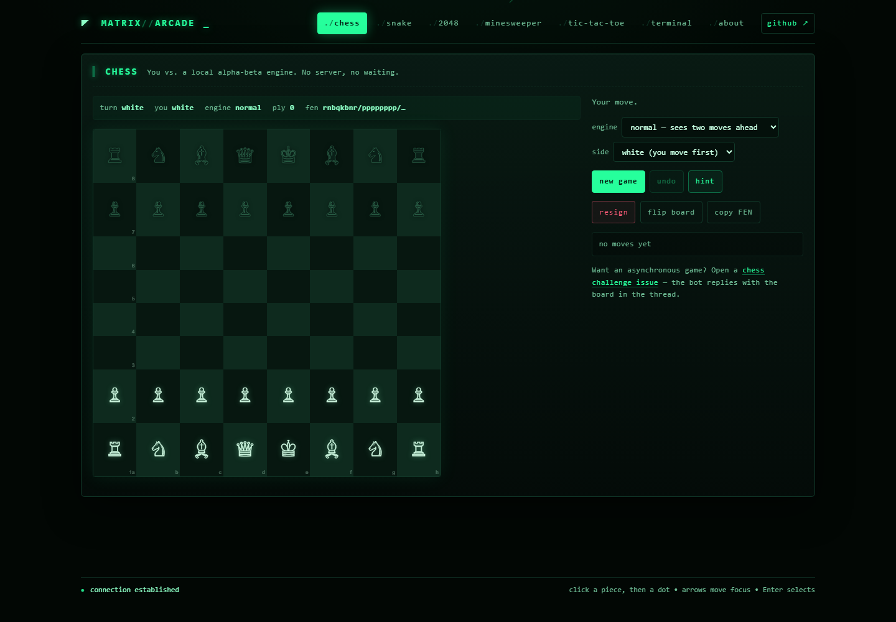
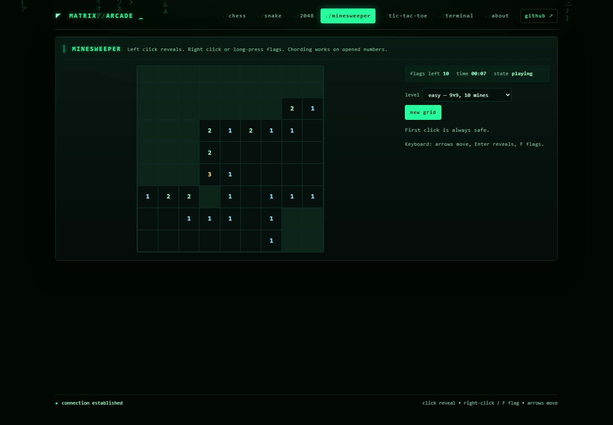
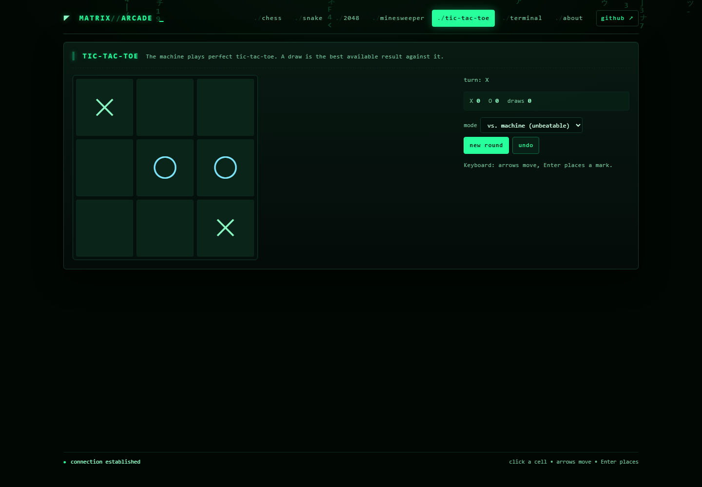
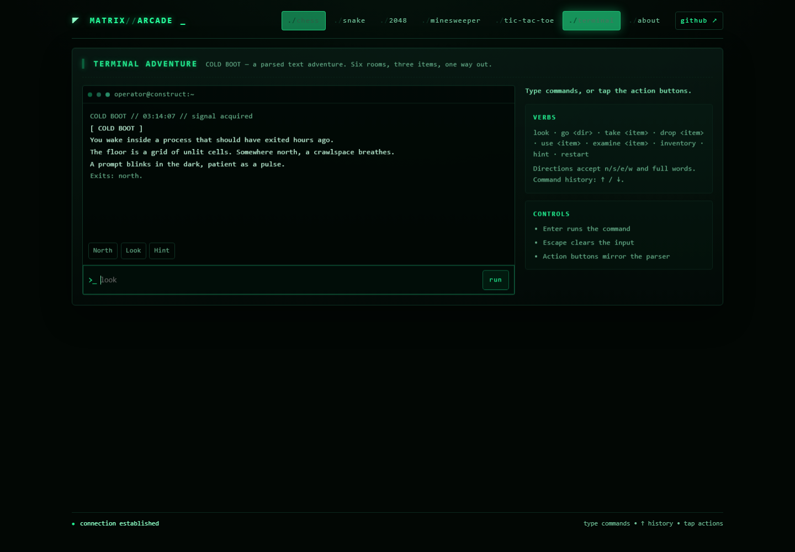

### `> Asato Ma Sad Gamaya`

Doth mother know you weareth her drapes?

[ **JACK IN →** ](https://ajaybe-ops.github.io/ajaybe-ops/arcade/) &nbsp;·&nbsp; [ play chess by issue ](https://github.com/ajaybe-ops/ajaybe-ops/issues/new?template=chess.yml&title=Chess%20challenge)

---

## `> ./play --list`

<table>
<tr>
<td align="center" width="50%">

 <strong>CHESS vs MACHINE</strong>
 three difficulties · full legal rules
</td>
<td align="center" width="50%">

 <strong>SNAKE</strong>
 three speeds · swipe or keyboard
</td>
</tr>
<tr>
<td align="center" width="50%">

 <strong>2048</strong>
 undo · best score kept locally
</td>
<td align="center" width="50%">

 <strong>MINESWEEPER</strong>
 three sizes · flags · first-click safety
</td>
</tr>
<tr>
<td align="center" width="50%">

 <strong>TIC-TAC-TOE</strong>
 unbeatable machine opponent
</td>
<td align="center" width="50%">

 <strong>THE TERMINAL</strong>
 inventory · locked doors · multiple endings
</td>
</tr>
</table>

---

## `> whoami`

**Ajay Krishna M.** — AI engineering student at IIT G and builder of [Aegis MCP](https://github.com/ajaybe-ops/aegis-mcp). I work on LLM tooling, retrieval and reliability. The arcade is where I play.

[Portfolio](https://ajaybe-ops.github.io/) · [LinkedIn](https://www.linkedin.com/in/ajaykrishagi/) · [Email](mailto:ajaykrishiit.uk@gmail.com) · [X](https://x.com/jaykrishAGI)

Open to AI Engineer, LLM Engineer and Applied AI roles.

---

## `> stats --live`

Updated from GitHub every six hours.

---

`> wake up, neo...` · built with Node, CSS and far too much green · [MIT](LICENSE)

 

