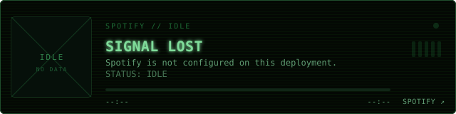
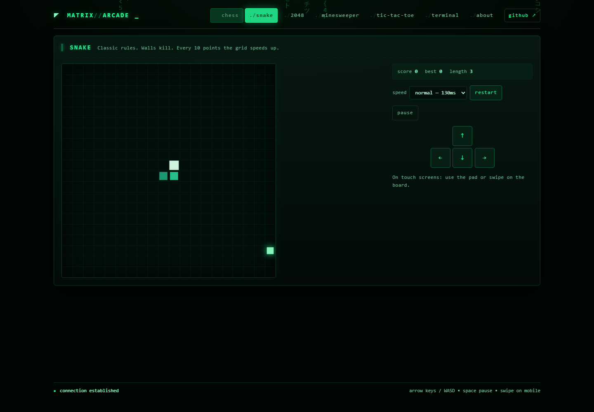
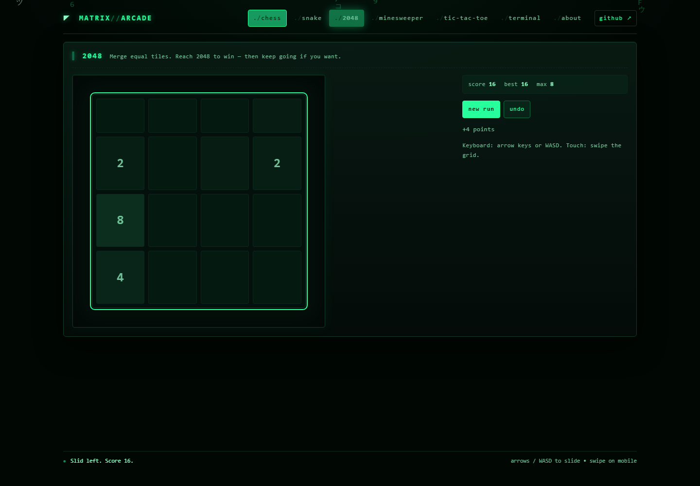
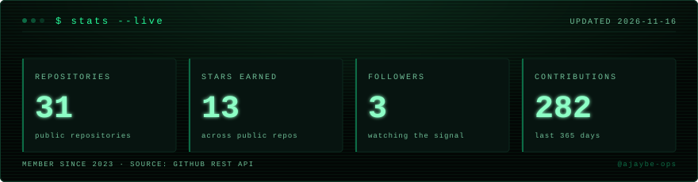
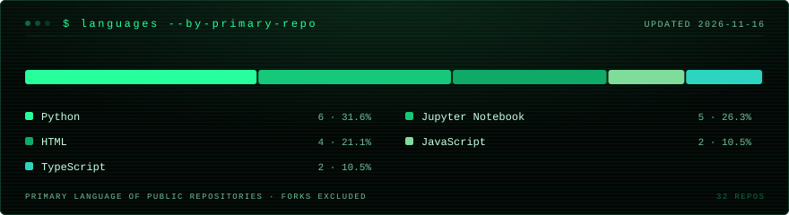

<div align="center">

<a href="https://ajaybe-ops.github.io/ajaybe-ops/arcade/">
  
</a>

### `> the arcade is real`

Six games. One hand-written chess engine. A bot that answers moves in GitHub Issues.

[ **JACK IN →** ](https://ajaybe-ops.github.io/ajaybe-ops/arcade/) &nbsp;·&nbsp; [ play chess by issue ](https://github.com/ajaybe-ops/ajaybe-ops/issues/new?template=chess.yml&title=Chess%20challenge) &nbsp;·&nbsp; [ how it works ](#how-it-works)

<sub>This README is static. The playable layer is GitHub Pages. No tracking, no build step, no framework.</sub>

<br />



<sub>A Vercel function renders this from the Spotify Web API. Until it is deployed, the committed card says exactly that — no fake track, no fake equalizer.</sub>

</div>

---

## `> ./play --list`

The screenshots below are not mockups — they were captured from the running arcade in a real browser. GitHub does not execute JavaScript inside a README, so each one links to the playable page.

<table>
<tr>
<td align="center" width="50%">
<a href="https://ajaybe-ops.github.io/ajaybe-ops/arcade/#chess"></a>
<br /><strong>CHESS vs MACHINE</strong>
<br /><sub>alpha–beta engine · three depths · full legal rules</sub>
</td>
<td align="center" width="50%">
<a href="https://ajaybe-ops.github.io/ajaybe-ops/arcade/#snake"></a>
<br /><strong>SNAKE</strong>
<br /><sub>canvas · three speeds · walls kill · swipe + keyboard</sub>
</td>
</tr>
<tr>
<td align="center" width="50%">
<a href="https://ajaybe-ops.github.io/ajaybe-ops/arcade/#2048"></a>
<br /><strong>2048</strong>
<br /><sub>arrow keys or WASD · undo · best score kept locally</sub>
</td>
<td align="center" width="50%">
<a href="https://ajaybe-ops.github.io/ajaybe-ops/arcade/#mines"></a>
<br /><strong>MINESWEEPER</strong>
<br /><sub>three sizes · first-click safety · flags · chording</sub>
</td>
</tr>
<tr>
<td align="center" width="50%">
<a href="https://ajaybe-ops.github.io/ajaybe-ops/arcade/#tictactoe"></a>
<br /><strong>TIC-TAC-TOE</strong>
<br /><sub>minimax opponent · it will not let you win</sub>
</td>
<td align="center" width="50%">
<a href="https://ajaybe-ops.github.io/ajaybe-ops/arcade/#terminal"></a>
<br /><strong>THE TERMINAL</strong>
<br /><sub>inventory · locked doors · multiple endings</sub>
</td>
</tr>
</table>

The arcade is fifteen hand-written ES modules, one CSS file and zero runtime dependencies. It works offline once loaded, keeps scores locally, and never phones home.

---

## Chess, two ways

### 1. Instantly, in the browser

[**Open the board →**](https://ajaybe-ops.github.io/ajaybe-ops/arcade/#chess)

The engine is a small 0x88 implementation with alpha–beta search, quiescence and piece-square tables. The search is deterministic; the browser adds a light random tie-break so equal-cost moves vary, while the CLI and Issue bot do not. It was validated against the published perft counts for the starting position, Kiwipete and two standard test positions before it was allowed near a README.

### 2. Asynchronously, through GitHub Issues

[**Start a game by opening an issue →**](https://github.com/ajaybe-ops/ajaybe-ops/issues/new?template=chess.yml&title=Chess%20challenge)

The bot replies with the board, then you comment moves:

```text
e4
```

or `Nf3`, `exd5`, `O-O`, `e8=Q`, or coordinates like `e2e4`. Commands: `/board`, `/fen`, `/resign`, `/new`, `/help`.

Every game is a JSON file committed to [`chess/games/`](chess/games) by a GitHub Actions workflow. The bot is stateless: the repository is the database, and every move is auditable in git history. There is no server to keep alive and no database to leak.

```text
  +------------------------+
8 | r  n  b  q  k  b  n  r |
7 | p  p  p  p  p  p  p  p |
6 | .  .  .  .  .  .  .  . |
5 | .  .  .  .  .  .  .  . |
4 | .  .  .  .  .  .  .  . |
3 | .  .  .  .  .  .  .  . |
2 | P  P  P  P  P  P  P  P |
1 | R  N  B  Q  K  B  N  R |
  +------------------------+
    a  b  c  d  e  f  g  h
```

---

## `> cat now-playing.txt`

A Vercel function refreshes an OAuth token, asks Spotify what is playing, inlines the album art as a data URI (README SVG cannot load external images), and returns a self-contained animated SVG. Three environment variables, no SDK, no exposed secrets. When nothing is playing it renders an idle card instead of pretending.

[Setup guide →](docs/SETUP.md#3-spotify-now-playing-badge)

---

## `> stats --live`

<div align="center">





<sub>Generated from the GitHub API by <code>.github/workflows/profile-assets.yml</code> every six hours. Nothing here is hard-coded.</sub>

</div>

---

## `> whoami`

I'm **Ajay Krishna M.**, an AI engineering student at **IIT G** and the builder behind [Aegis MCP](https://github.com/ajaybe-ops/aegis-mcp). My work sits where LLM tooling, retrieval and reliability engineering meet: typed tool surfaces for agents, deterministic risk scoring, and evidence-contract evaluations for RAG. I care about systems that can be re-run, audited and operated — and about making the front door worth opening.

**Open to** AI Engineer, LLM Engineer and Applied AI roles.

[Portfolio](https://ajaybe-ops.github.io/) · [LinkedIn](https://www.linkedin.com/in/ajaykrishagi/) · [Email](mailto:ajaykrishiit.uk@gmail.com) · [X](https://x.com/jaykrishAGI)

| selected work | verification |
| :--- | :--- |
| [Aegis MCP](https://github.com/ajaybe-ops/aegis-mcp) — MCP server for vulnerability intelligence and incident triage | 171 tests, 91.74% coverage, 12/12 evals |
| [Enterprise RAG](https://github.com/ajaybe-ops/enterprise-rag) — auditable hybrid retrieval with evidence contracts | 149 tests, recall@5 0.950, 0 authorization violations |
| [TensorTonic](https://github.com/ajaybe-ops/TensorTonic-Solutions) — 105 ML/DL primitives from scratch | 105 problem directories, 105 implementations |

<sub>Numbers come from the linked repositories; their READMEs carry the long version. The arcade is the fun layer — the work above is what I do when I am not building games.</sub>

---

## How it works

| layer | implementation | where it runs |
| :--- | :--- | :--- |
| Profile visuals | hand-authored SVG with CSS keyframes and SMIL-free animation | GitHub README renderer |
| Static assets | deterministic Node scripts, seeded PRNG, no image libraries | `scripts/generate-assets.mjs` |
| Arcade | vanilla ES modules, canvas + DOM, no bundler | GitHub Pages |
| Chess rules | 0x88 engine shared by browser, CLI and Issue bot | `lib/chess.js` |
| Async chess | Issues → Actions → committed JSON → Markdown reply | `.github/workflows/chess-bot.yml` |
| Spotify badge | Vercel serverless function, token refresh, inlined artwork | `api/now-playing.js` |
| GitHub stats | REST + optional GraphQL calendar, rendered to SVG | `.github/workflows/profile-assets.yml` |

There is no framework, no npm dependency, no analytics and no external service in the critical path except GitHub itself. The only third-party runtime is Spotify's API and, if you deploy it, Vercel's free tier.

---

## Honest limits

Most profile projects quietly skip this section. Here is what this one cannot do:

- **READMEs cannot run JavaScript.** No game is playable inside the Markdown itself; the images link to GitHub Pages, where the arcade actually runs.
- **Async chess is not instant.** GitHub Actions can take seconds or a cold minute to reply. The bot serialises moves per issue, and a conflicting double-comment is refused rather than silently merged.
- **Threefold repetition is not tracked across Issue comments.** Each reply reloads the FEN, so the bot has the current position but not the full move history. The browser game keeps history and does detect it. The 50-move clock survives in the FEN and is adjudicated.
- **Spotify needs an active session.** The badge observes playback; it cannot start music. If the account is idle, it shows an idle card. The function caches for 60 seconds while playing, so the badge is "now playing", not "now playing to the millisecond".
- **Stats refresh every six hours**, not continuously. GitHub also caches images; a hard refresh may still show the old SVG for a few minutes.
- **Contribution data needs a token with `read:user`.** Without it, the card says the feed is unavailable instead of inventing a graph. The REST-only cards still update.
- **This copy is configured for `@ajaybe-ops`.** A fork keeps these links until you replace the handle; the site does not guess who owns it. That is deliberate: no hidden magic.

---

## Run it locally

```bash
git clone https://github.com/ajaybe-ops/ajaybe-ops.git
cd ajaybe-ops
node scripts/dev-server.mjs
# arcade: http://127.0.0.1:4173/arcade/
```

No `npm install` is required. Node 20+ is enough.

```bash
npm test                    # 79 tests: rules, games, bot, Spotify, SVG
node scripts/chess-cli.mjs  # play the engine in your terminal
```

---

## Make it yours

1. [Fork this repository](https://github.com/ajaybe-ops/ajaybe-ops/fork).
2. Replace `ajaybe-ops` with your handle, then run `node scripts/generate-assets.mjs --username your-handle` to rebuild the banner and terminal card.
3. Enable **Settings → Pages → Source: GitHub Actions**.
4. Add a `PROFILE_TOKEN` secret (PAT with `read:user`) if you want the contribution calendar, then run the *Refresh profile assets* workflow.
5. Deploy `api/` to Vercel and point the Spotify `` at `https://your-app.vercel.app/api/now-playing`.

Full instructions, permissions and troubleshooting: [docs/SETUP.md](docs/SETUP.md).
Architecture and trade-offs: [docs/ARCHITECTURE.md](docs/ARCHITECTURE.md).
Security model: [docs/SECURITY.md](docs/SECURITY.md).
What GitHub will and will not allow: [docs/GITHUB-LIMITS.md](docs/GITHUB-LIMITS.md).

---

<div align="center">

<sub>`> wake up, neo...` · built with Node, CSS and far too much green · [MIT](LICENSE)</sub>

<br />

<a href="https://ajaybe-ops.github.io/ajaybe-ops/arcade/"></a>

</div>
